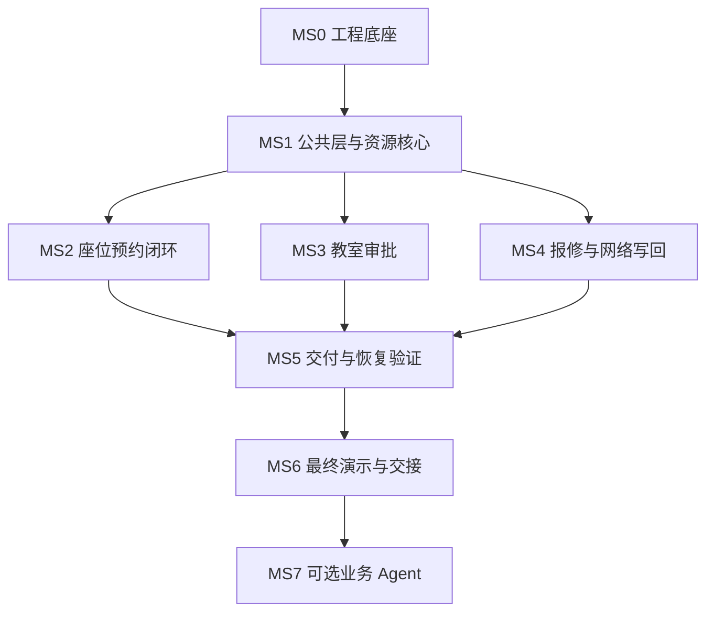

# 校园资源服务平台 开发里程碑与任务执行规范

> 实施说明（2026-10-22）：用户已明确指定 GitLab、自主提交与本地可迁移交付，邮件先使用本地测试服务。当前交付边界和原文流程的适用调整见 [ADR 0002](docs/adr/0002-delivery-and-gitlab.md)。业务规则与未调整的验收标准继续保留。

文档版本：1.0。适用范围：六人团队、三个模块组、课程 PJ 的 P0 开发与可选 P1 扩展。本文是下游 AI Agent 的任务执行清单。文中所有任务的初始状态均为 `NOT_STARTED`；本文不表示任何代码、部署或验收已经完成。

本文件必须与 [01_PRD.md](01_PRD.md)、[02_Technical_Design.md](02_Technical_Design.md) 一起使用。业务规则、状态和验收条件以 PRD 为准；接口、数据结构和实现约束以技术方案为准；本文确定实施顺序、责任、交付物和阶段门禁。若三者冲突，Agent 必须记录冲突并暂停相关变更，由负责人先修订基线；不得自行选择一种解释实现。

## 1. 执行目标与固定约束

P0 目标是交付一个可从空环境部署、具有真实业务闭环、可以追溯发布版本并能够回滚的系统。P0 完成后，才允许启动自然语言业务 Agent 扩展。

以下技术决策已经确定，任务执行时不得重新选型：

- 后端：Java、Spring Boot、Spring Data JPA、Spring Security、Spring Session JDBC。
- 数据库与迁移：PostgreSQL、Flyway。
- 前端：React、TypeScript、Umi、Ant Design；从空业务页面开始开发。
- 部署：单仓库，`core-service`、`repair-service`、`web` 三个应用产物；Nginx 同源入口；Docker Compose；GitHub Actions。
- `core-service` 承载 D、M1、M2；`repair-service` 承载 M3。M3 通过 HTTP 调用 core 的资源接口。
- core 是资源占用与维修封禁的唯一写入方。M3 不直接查询或更新 core 的业务表。
- 不采用完整后台业务项目改造；不增加 Redis、消息队列、工作流引擎或 Kubernetes。
- 一次发布包含整套应用；测试与生产推广同一批镜像 digest。
- 数据库结构变更只通过版本化迁移；禁止手工改生产库，禁止运行时 ORM 自动改表。

课程任务书没有规定统一完成日期。下文的六周安排是团队启动时采用的相对计划，不是外部截止时间或交付承诺。若资源不足，调整任务日期与优先级，不得删掉未完成的需求或降低既定门禁。

## 2. 人员与公共层责任

首次启动会议必须将以下占位角色映射到真实成员的 GitHub 账号，并提交到 `docs/team.md`。映射完成前，任务可以进入分析，但不能合并业务代码。一个人可以承担多项职责；任务负责人、验收人和生产审批人仍必须按本文分离。

| 成员标识 | 模块组 | 主要责任 | 公共层责任 |
|---|---|---|---|
| A1 | M1 组 | 预约后端、资源可用性与锁协议 | 空间主数据、资源接口负责人 |
| A2 | M1 组 | 学生前端、M1 测试与集成 | 前端公共布局、关键业务 E2E |
| B1 | M2 组 | 审批后端、审批事务 | 身份、RBAC、数据范围 |
| B2 | M2 组 | 审批前端、接口契约 | OpenAPI、迁移评审与需求追踪 |
| C1 | M3 组 | 报修后端、HTTP 同步与恢复 | 通知、审计、持久化任务基础模块 |
| C2 | M3 组 | 报修前端、部署与发布 | CI/CD、环境、发布与恢复手册 |

公共层代码可以位于 `core-service`，但开发责任按上表分配。模块归属、故障响应人、评审人和工作量分配必须写入 `docs/adr/0001-module-and-shared-layer-ownership.md`，记录三组同意的依据。公共层开发量计入对应成员的任务，不视为无人负责的额外工作。

| 变更类型 | 必须参加的人审 |
|---|---|
| 单模块内部业务变更 | 同组另一成员 |
| 资源占用、锁顺序、M2 或 M3 写回 | A1 与受影响模块负责人；作者不得自审 |
| 登录、权限、会话 | B1 与至少一个调用方负责人；作者不得自审 |
| schema、索引、迁移、种子数据 | B2 与数据所属模块负责人；作者不得自审 |
| API、错误码、状态枚举 | B2 与前后端调用方 |
| 发布、生产配置、密钥注入 | C2 与另一组指定审核人 |

若表中指定审核人就是作者，应由其同组另一成员代替作者完成该审核席位。跨模块变更至少包含两组成员的审核记录。

## 3. 状态、任务与证据管理

任务状态只允许：

`NOT_STARTED → READY → IN_PROGRESS → IN_REVIEW → DONE`。

允许从任一未完成状态进入 `BLOCKED`。解除阻塞后回到之前的状态；不得直接标记 DONE。审核失败回到 IN_PROGRESS。需求取消必须保留任务，标记 `CANCELLED_BY_ADR` 并关联获批的变更记录。

- `READY`：所有前置任务已 DONE，负责人已读取相关需求、接口与验收条件。
- `IN_PROGRESS`：一个任务只允许一个主要执行 Agent；并行 Agent 只能在负责人明确划分的文件范围内工作。
- `IN_REVIEW`：实现与必要验证已完成，负责人已经得到变更摘要和证据。
- `DONE`：满足本节的全部完成条件，且对应 PR 已合并。

每项任务的完成条件：

1. 对应 REQ 的实现和测试均可定位，未实现内容明确列出。
2. 必要测试通过；没有跳过失败测试、弱化断言或 mock 被测业务本身。
3. 人工验收 AI 变更后再形成提交；PR 中记录验收人及验收证据。合并前还要完成规定的代码审核。
4. 提交说明包含任务号和需求号，例如 `T20-01 REQ-M1-02: enforce reservation overlap rules`。
5. API、schema、配置、界面或状态变化同步更新对应契约与文档。
6. 不包含明文密钥、生产数据、无关重构或未说明的框架升级。
7. 变更合入 main 后，整套测试环境自动部署成功；若本任务发生在首次部署之前，以 T00-05 的验收补齐该项。

证据采用仓库中的文本索引与 CI 链接，不提交真实个人数据。建议目录为 `docs/evidence/<task-id>/`。保存测试命令、测试结果、commit、PR、流水线运行链接、发布清单和人工验收记录。视频可作为演示补充，截图和聊天记录不能代替可重放的测试及提交历史。

合并冲突必须由人处理。Agent 可以说明冲突的两侧语义及风险，但不得自行解决冲突并提交合并结果。

## 4. 里程碑、相对排期与关键依赖

为避免与业务模块 M1/M2/M3 混淆，里程碑使用 `MS0` 至 `MS7`。

| 里程碑 | 相对窗口 | 阶段结果 | 进入下一阶段的门禁 |
|---|---|---|---|
| MS0 工程底座 | 第 1 周前半 | 空项目已自动部署，空库迁移可重放 | G0 通过 |
| MS1 公共层与资源核心 | 第 1 周后半至第 2 周前半 | 登录、授权、主数据、资源裁决可用 | G1 通过 |
| MS2 座位预约闭环 | 第 2 周至第 3 周前半 | 搜索、预约、签到、超时、历史与统计可用 | G2 通过；第一次 Review |
| MS3 教室审批 | 第 3 周 | 两级审批与资源占用原子提交 | G3 通过 |
| MS4 报修与网络写回 | 第 3 周后半至第 4 周 | 维修封禁、验收恢复与失败重试可用 | G4 通过；第二次 Review |
| MS5 交付与恢复验证 | 第 5 周 | 全量验收、发布晋级、兼容回退、恢复验证 | G5 通过 |
| MS6 最终演示与交接 | 第 6 周 | 完整演示与证据可复现 | G6 通过；P0 DONE |
| MS7 业务 Agent | P0 DONE 后单独安排 | DSH 插件通过公开 API 完成业务 | G7 通过；可选 P1 |

MS3 与 MS4 可以并行，但必须等待各任务的明确依赖。MS3、MS4 的完整集成验收仍需要 MS2 的真实预约能力。不得使用假预约数据接口代替已实现模块。



以下为 40 个 P0 任务与 3 个 P1 任务。任务依赖是强制条件；相对周次不覆盖依赖关系。

## 5. MS0 工程底座

### T00-01 建立仓库规则与需求基线

- 状态：`NOT_STARTED`。负责人：B2；共同参与：全部成员。前置：无。
- 需求：REQ-ENG-01、REQ-ENG-08。
- 交付：三份基线文档、`AGENTS.md`、`docs/team.md`、公共层归属 ADR、PR 模板、需求追踪表、风险与伦理记录模板。
- 验收：三组认领完成；每项需求可映射到任务与验收；规则明确人工验收、冲突处理和禁止事项；固定依赖主版本与锁文件策略由技术负责人记录。基线经三组人审后提交。
- 证据：启动会议决策、首次提交和 PR；不能在期末补造提交历史。

### T00-02 建立空应用与统一契约

- 状态：`NOT_STARTED`。负责人：A1；协作：B2、C1。前置：T00-01。
- 需求：REQ-ENG-01、REQ-ENG-02、REQ-ENG-05。
- 交付：两个可启动 Spring Boot 应用、一个 React/Umi 应用、公共 DTO/错误格式、健康与版本接口、OpenAPI 初稿、构建与类型检查命令；已验证的工具链与依赖版本 ADR、构建工具 Wrapper、前端 lockfile 和基础镜像版本记录。
- 验收：从各项目官方稳定维护版本中选择兼容组合并实际构建验证，之后锁定精确版本；不得使用 `latest`、snapshot 或未验证的任意升级。三个应用从干净 checkout 可构建；前端展示后端版本；错误格式、UUID、时间、分页与请求编号遵循技术方案；不包含现成校园业务实现。
- 证据：干净构建日志、接口契约验证、浏览器冒烟记录。

### T00-03 建立环境与脚本化初始化

- 状态：`NOT_STARTED`。负责人：C2；协作：A1。前置：T00-02。
- 需求：REQ-ENG-04、REQ-ENG-07、REQ-ENG-08。
- 交付：Compose 基础配置、local/dev/test/prod 配置入口、Nginx 路由、bootstrap 脚本、数据库角色和持久卷、密钥注入说明。
- 验收：从无应用数据的目标环境执行脚本即可启动全部服务；各环境卷、库、账号、会话与通知隔离；公共入口不能访问 `/internal/v1`；数据库未开放到公网；脚本重复运行不清空数据。
- 证据：空环境执行日志、隔离验证及内部接口拒绝测试。

### T00-04 建立迁移与种子数据流程

- 状态：`NOT_STARTED`。负责人：B2；协作：C2。前置：T00-03。
- 需求：REQ-ENG-03、REQ-ENG-04。
- 交付：Flyway 独立执行任务、迁移目录与命名规则、schema 权限、基础种子数据与演示种子数据分离入口。
- 验收：空库一次执行到最新版本；第二次 migrate 不重复执行旧迁移；seed 连续运行两次不增加重复记录；运行时账号不能执行 DDL；运行应用仅验证 schema；生产没有测试订单和默认演示密码。
- 证据：迁移历史、两次 seed 后行数与业务键对比、DDL 拒绝测试。

### T00-05 完成首次自动构建与测试部署

- 状态：`NOT_STARTED`。负责人：C2；协作：A2。前置：T00-04。
- 需求：REQ-ENG-02、REQ-ENG-05。
- 交付：push/PR 构建检查、main 合并后的镜像构建和整套 test 部署、环境锁、初版健康冒烟测试。
- 验收：一个实际 PR 自动触发检查；人为引入编译或测试错误时，合并及部署被阻止；修复并合入 main 后，web 与两个服务自动部署，显示同一 commit。一次流水线覆盖全部应用。
- 证据：失败与成功两次运行链接、部署后的三个版本响应。该任务不得延期到业务功能完成之后。

### T00-06 完成初版生产发布与回退通路

- 状态：`NOT_STARTED`。负责人：C2；验收：B2。前置：T00-05。
- 需求：REQ-ENG-06、REQ-ENG-07。
- 交付：发布清单格式、镜像保留策略、人工审批入口、prod 部署与回退脚本的第一版。
- 验收：对两个仅有版本文字差异的空应用版本执行发布和回退；生产使用 test 验证的 digest；无审批的流水线不能发布；页面能指出当前版本。私有仓库审批能力按技术方案选定并实际验证，不能假设套餐具有 required reviewers。
- 证据：审批记录、两版 manifest、生产版本变化和回退日志。此项只验证通路；数据兼容回退仍由 T50-04 至 T50-06 验收。

G0 门禁：T00-01 至 T00-06 全部 DONE。失败时禁止把业务代码合入缺少构建门禁的主分支；允许在有审查的任务分支继续准备业务设计。

## 6. MS1 公共层与资源核心

### T10-01 实现账户与共享会话

- 状态：`NOT_STARTED`。负责人：B1；协作：A2。前置：T00-04、T00-05。
- 需求：REQ-D-01、REQ-ENG-08。
- 交付：用户实体与必要管理 API、Spring Security 登录/退出、密码编码、Spring Session JDBC、登录页面、会话测试。
- 验收：正确凭据登录，错误凭据拒绝；退出后会话失效；两个服务识别同一用户；停启应用后未过期会话仍按规则工作；账号禁用使后续受保护请求失败；日志不记录密码、完整 Cookie 或会话秘密。
- 证据：真实 HTTP 认证测试和两个服务的权限边界测试。

### T10-02 实现 RBAC 与数据范围

- 状态：`NOT_STARTED`。负责人：B1；协作：B2、C1。前置：T10-01。
- 需求：REQ-D-02、REQ-D-03。
- 交付：角色/权限/范围关系、管理页面、D 授权接口、M3 授权客户端、系统默认角色种子数据。
- 验收：新角色可以组合已有 permission keys；院系外学生不能预约受限教室；ROOM_APPLICANT 可以按授权范围提交 M2 申请，普通 STUDENT 不自动获得该资格；审批人、物业和教室管理员只访问授权范围；SYSTEM_ADMIN 不自动获得审批资格；变更权限后旧会话按技术方案失效；直接 API 调用不能绕过前端限制。
- 证据：角色×资源范围测试矩阵，至少包含允许、拒绝和角色变更三类结果。

### T10-03 实现空间与开放规则管理

- 状态：`NOT_STARTED`。负责人：A1；协作：A2。前置：T10-02。
- 需求：REQ-D-04、REQ-D-05。
- 交付：教室、座位、开放规则、插座标记、配置 API 与管理页面；相关迁移和固定种子数据。
- 验收：编号唯一；院系限制生效；关闭或注销行为按 PRD 检查既有业务；跨午夜开放配置按基线拆分；M1/M2 可配置时长与固定14天预约窗口均有服务端校验，前端不能绕过。
- 证据：配置边界测试、管理权限测试和页面操作记录。

### T10-04 实现统一资源裁决

- 状态：`NOT_STARTED`。负责人：A1；审核：B1、C1。前置：T10-03。
- 需求：REQ-X-01、REQ-X-02、REQ-X-04。
- 交付：`resource_claim`、来源约束、时间交叠查询、房间锁接口、用户预约 guard、资源写入服务与针对性集成测试。
- 验收：M1/M2/M3 来源可追溯；整室与单座范围均影响查询；相邻半开区间不冲突；两张维修封禁解除一张后另一张仍生效；不同房间的并发写互不等待同一房间锁；所有写路径遵守统一锁序。
- 证据：真实 PostgreSQL 集成测试，包含并发屏障而非顺序调用伪装并发。

### T10-05 实现通知、审计与持久化任务基础

- 状态：`NOT_STARTED`。负责人：C1；协作：B2。前置：T10-01、T00-04。
- 需求：REQ-D-06、REQ-D-07、REQ-X-03。
- 交付：通知发送适配器、通知记录、审计事件、数据库任务记录、扫描与重试骨架、outbox/命令去重基础；不含各业务的状态处理规则。
- 验收：数据库事务内记录任务和审计；事务回滚不留下待发送成功业务通知；进程重启后仍能找到未完成任务；重复处理不会重复产生业务状态变更；邮件失败可见且可重试；不在持有房间锁时执行 HTTP 或 SMTP。
- 证据：重启恢复测试、事务回滚测试、失败重试与审计脱敏检查。

### T10-06 建立前端公共交互与接口接入

- 状态：`NOT_STARTED`。负责人：A2；协作：B2、C2。前置：T10-01、T10-02、T00-02。
- 需求：REQ-D-01、REQ-D-02、REQ-ENG-02。
- 交付：学生与管理布局、路由、请求封装、CSRF 接入、统一错误展示、状态标签、分页、加载/空数据/无权限状态。
- 验收：API 使用同源相对地址；TypeScript 检查独立执行；写请求带幂等键；重试不自动生成新键；409 能展示业务冲突；网络超时页面不直接显示操作失败或成功；移动端宽度下核心表单可操作。
- 证据：公共页面测试、请求契约测试、生产构建与 test 构建产物同一性的检查。

G1 门禁：T10-01 至 T10-06 全部 DONE。资源模型、授权契约和锁序经过三组评审。后续任务不得各自实现第二套身份或资源可用性逻辑。

## 7. MS2 座位预约闭环

### T20-01 实现搜索与并发预约

- 状态：`NOT_STARTED`。负责人：A1；协作：A2。前置：T10-02、T10-03、T10-04。
- 需求：REQ-M1-01、REQ-M1-02、REQ-X-01。
- 交付：按教室、时段、插座筛选的查询；预约创建 API；用户 guard 与房间锁事务；预约页面。
- 验收：整点、开放时间、默认最长 4 小时、14 天窗口均被后端验证；同一学生跨房间重叠预约被拒绝；同座同时段 20 个并发请求恰有一个成功；请求幂等重放返回原业务结果。
- 证据：成功路径、边界输入、跨房间用户冲突及真实并发测试。

### T20-02 实现取消与预约状态迁移

- 状态：`NOT_STARTED`。负责人：A1；协作：A2。前置：T20-01、T10-05。
- 需求：REQ-M1-03、REQ-X-01。
- 交付：取消接口、状态迁移守卫、资源释放、审计与通知任务、前端操作入口。
- 验收：用户只可取消本人且尚未开始的 RESERVED 预约；重复取消不重复释放或通知；终态不可复活；expectedVersion 不匹配返回 409；其他预约和封禁不被解除。
- 证据：状态迁移表驱动测试、越权测试与幂等测试。

### T20-03 实现每日教室码与签到

- 状态：`NOT_STARTED`。负责人：A1；协作：A2、B1。前置：T20-01、T10-02。
- 需求：REQ-M1-04、REQ-D-07、REQ-ENG-08。
- 交付：每日教室码管理、受限屏幕页面、签到 API、输入编码页面、尝试次数限制。
- 验收：仅在 `[start,start+15min)` 签到；错教室、错日期、错码、非本人预约均拒绝；每天 00:00 后旧码失效；普通查询 API 不泄露当天码；重复签到结果稳定；边界测试使用可注入服务端 Clock。
- 证据：时间边界、权限、限流、码泄露检查；不得以真实等待十五分钟代替自动测试。

### T20-04 实现提醒、超时与完成任务

- 状态：`NOT_STARTED`。负责人：C1；协作：A1。前置：T20-02、T20-03、T10-05。
- 需求：REQ-M1-05、REQ-D-06。
- 交付：开始前 15 分钟提醒、开始后 10 分钟提醒、15 分钟未签到取消与违约、预约结束完成任务。
- 验收：同一预约最多一次违约；签到与超时任务竞争只能产生一个符合时间规则的结果；维修取消不记违约；重启后补偿未完成的有效事件，不发送已过期的 LATE 提醒；健康运行时到期处理延迟符合 PRD。
- 证据：可控时钟测试、重复扫描测试、进程停启测试及邮件发送结果。

### T20-05 实现历史复用与运营统计

- 状态：`NOT_STARTED`。负责人：A2；协作：A1。前置：T20-04、T10-06。
- 需求：REQ-M1-06、REQ-M1-07、REQ-D-03。
- 交付：本人历史、再次预约入口、运营聚合统计、查询 API 与页面。
- 验收：再次预约创建新请求并重新验证权限/时间/可用性，不复制旧状态；统计按 PRD 口径区分预约、签到、取消和违约；OPERATOR 只能访问允许的聚合/范围信息；普通学生不能查询他人历史。
- 证据：固定数据集的预期统计值、接口权限检查与页面流程测试。

### T20-06 验收 M1 完整闭环并准备第一次 Review

- 状态：`NOT_STARTED`。负责人：A2；审核：B2。前置：T20-01 至 T20-05。
- 需求：REQ-M1-01 至 REQ-M1-07、REQ-ENG-01、REQ-ENG-02。
- 交付：M1 全流程 E2E、并发与越权测试套件、需求实现映射、第一次 Review 演示清单。
- 验收：真实前端、后端与 PostgreSQL 完成搜索→预约→签到→完成及超时路径；故意移除一条冲突/权限判断后，相应测试失败；恢复正确代码后测试通过；未完成跨模块功能仍在清单中显示未完成。
- 证据：通过报告、故意破坏后的失败报告、需求追踪表、AI 人工验收样例。

G2 门禁：T20-01 至 T20-06 全部 DONE。第一次 Review 展示基线、分工、架构、已部署的 M1、AI 规则与风险记录；不得将 MS3/MS4 未完成部分描述成已完成。

## 8. MS3 教室申请与两级审批

### T30-01 实现申请与审批步骤模型

- 状态：`NOT_STARTED`。负责人：B1；协作：B2。前置：T10-02、T10-03、T10-05。
- 需求：REQ-M2-01、REQ-M2-05。
- 交付：申请、步骤、操作历史实体和迁移；创建、本人列表、详情 API；DEPT_APPROVER→SPACE_APPROVER 两级配置。
- 验收：申请字段与时间合法；提交人具有 ROOM_APPLICANT 或等效 permission key 及相应资源范围，只有 STUDENT 权限时拒绝；提交时发现当前维修封禁或现有 M1/M2 占用冲突则拒绝；期限为 `min(created+24h,start)`；PENDING 不写资源占用；内容不可直接编辑；详情和历史不泄露他人申请。
- 证据：创建边界、期限计算、待审批无占用及越权测试。

### T30-02 实现审批与最终占用事务

- 状态：`NOT_STARTED`。负责人：B1；审核：A1。前置：T30-01、T10-04。
- 需求：REQ-M2-02、REQ-M2-04、REQ-X-02。
- 交付：通过/驳回接口、顺序守卫、职责分离校验、最终审批与资源占用的单事务实现。
- 验收：申请人不可自批，同一人不能批准两个步骤；不能跳级；最终审批检查冲突；冲突返回 409，步骤仍为 PENDING，没有成功决定和占用残留；无冲突时审批决定、APPROVED、claim 与审计一起提交。
- 证据：事务失败注入、审批权限、重复审批及整室/单座冲突测试。

### T30-03 实现撤销、过期与结束

- 状态：`NOT_STARTED`。负责人：B1；协作：C1。前置：T30-02、T10-05。
- 需求：REQ-M2-03、REQ-M2-04。
- 交付：申请撤销、管理员取消、自动过期、结束转 COMPLETED、对应资源释放和通知。
- 验收：已批准申请只有开始前允许申请人撤销；`now>=expires_at` 不再允许审批；审批与过期并发后只有一个最终结果；PENDING 无 claim 时释放为安全空操作；结束与取消只解除本申请的占用。
- 证据：时钟边界与并发测试、资源来源隔离测试。

### T30-04 实现审批端与申请端页面

- 状态：`NOT_STARTED`。负责人：B2。前置：T30-01、T30-02、T30-03、T10-06。
- 需求：REQ-M2-01 至 REQ-M2-05。
- 交付：申请表、我的申请、审批待办、审批详情、步骤时间线、冲突反馈和撤销入口。
- 验收：使用 Ant Design 组件完成交互；按钮与后端权限一致；最终占用失败时显示具体冲突，不显示审批成功；同一页面刷新后反映服务端状态；申请内容修改通过撤销并重新提交实现。
- 证据：不同角色的真实接口页面测试、409 与网络超时交互测试。

### T30-05 验收 M2 与 M1 的并发集成

- 状态：`NOT_STARTED`。负责人：B2；审核：A1、A2。前置：T30-04、T20-06。
- 需求：REQ-M2-04、REQ-X-02、REQ-ENG-02。
- 交付：审批与个人预约竞态测试、整室释放测试、申请过期测试、需求映射。
- 验收：最终审批与同室个人预约同时执行时，不产生相互冲突的两个成功结果；通过后该时段所有座位不可预约；取消后仍保留其他来源封禁；最终审批失败不残留已通过步骤记录。
- 证据：真实 PostgreSQL 并发报告，故意移除最终资源检查后的失败报告。

G3 门禁：T30-01 至 T30-05 全部 DONE。不得通过前端先查询空闲再提交审批的方式替代后端原子检查。

## 9. MS4 报修与真实网络写回

### T40-01 实现故障上报与取消

- 状态：`NOT_STARTED`。负责人：C1；协作：C2。前置：T10-02、T10-03、T10-05。
- 需求：REQ-M3-01、REQ-M3-08。
- 交付：工单与历史迁移、上报/本人列表/详情/取消 API，字段校验与初版页面。
- 验收：房间存在且用户有权上报；相同房间允许多工单；报修人仅可取消 SUBMITTED；调度管理员只可取消授权范围内 SUBMITTED/ASSIGNED；后续状态禁止取消；首版不添加照片上传依赖。
- 证据：状态和权限矩阵、重复请求测试。

### T40-02 实现派单与超时升级

- 状态：`NOT_STARTED`。负责人：C1；协作：C2。前置：T40-01。
- 需求：REQ-M3-02、REQ-M3-07。
- 交付：派单/未开修重新派单接口、按教室授权的维修人员候选查询（经core内部API）、提交时人员资格复验、分配与完成期限、超时升级任务和通知收件人解析。
- 验收：只有范围内调度员可以派单；被分配者具有维修资格；分配截止为提交后 24 小时，完成截止为首次派单后 48 小时；ASSIGNED 重新派单保留历史且不延后截止，原维修人失去开修权限；逾期升级事件各记录一次；重复扫描不重复推进状态。
- 证据：可控时钟、重复扫描、范围与人员资格测试。

### T40-03 实现开始维修与封禁同步

- 状态：`NOT_STARTED`。负责人：C1；共同实现：A1。前置：T40-02、T10-04、T10-05、T20-04、T30-03。
- 需求：REQ-M3-03、REQ-X-03、REQ-X-04。
- 交付：BLOCK_PENDING、M3 outbox、core 维修封禁 HTTP 接口、服务身份校验、命令编号与来源版本处理。
- 验收：本地状态与命令一起提交；core 确认前不显示 IN_REPAIR；core 在房间事务中封禁并处理受影响预约；网络超时后重试同一命令；内部服务请求不能冒用普通用户身份扩大权限。
- 证据：两个独立容器的真实 HTTP 日志，包含共同 request/command 标识；禁止用直接方法调用或数据库脚本代替。

### T40-04 实现完工与验收状态

- 状态：`NOT_STARTED`。负责人：C1；协作：C2。前置：T40-03。
- 需求：REQ-M3-04、REQ-M3-05、REQ-M3-07。
- 交付：完工提交、验收通过/不通过、验收截止与超时通知。
- 验收：仅已指派维修人可提交完工；AWAITING_ACCEPTANCE 期间封禁继续有效；报修人或范围内物业管理员可验收，但实际维修人不得验收；不通过回到 IN_REPAIR 且不重复新建 block；超过完工后 48 小时只升级通知，不自动验收。
- 证据：状态路径、职责分离、重复验收和时间边界测试。

### T40-05 实现释放确认与失败恢复

- 状态：`NOT_STARTED`。负责人：C1；共同实现：A1。前置：T40-04。
- 需求：REQ-M3-05、REQ-X-01、REQ-X-03。
- 交付：RELEASE_PENDING、释放命令、core 来源版本与 tombstone、同步结果查询/对账和人工重试入口。
- 验收：确认释放后才 CLOSED；BLOCK 版本 1 的迟到请求不能覆盖 RELEASE 版本 2；同命令同内容可重放，不同内容被拒绝；释放只影响本工单；服务重启后可继续处理未确认命令。
- 证据：响应丢失、重复、乱序、停机与重启的故障注入测试；记录每条命令的最终结果。

### T40-06 完成工单页面与评价

- 状态：`NOT_STARTED`。负责人：C2。前置：T40-01 至 T40-05、T10-06。
- 需求：REQ-M3-01、REQ-M3-02、REQ-M3-03、REQ-M3-04、REQ-M3-05、REQ-M3-06、REQ-M3-07、REQ-M3-08。
- 交付：报修列表、派单视图、维修工作台、验收页面、状态历史、评价及同步异常提示。
- 验收：BLOCK_PENDING/RELEASE_PENDING 可见且不误报完成；不同角色只能看到允许动作；CLOSED 后只有报修人可评价一次，分值与长度符合 PRD；失败同步显示可追踪信息，不暴露凭据。
- 证据：多角色 E2E、输入边界与接口越权测试。

### T40-07 验收跨模块封禁、恢复与既有预约影响

- 状态：`NOT_STARTED`。负责人：A2；审核：A1、C1、B2。前置：T40-06、T20-06、T30-05。
- 需求：REQ-X-01 至 REQ-X-04、REQ-ENG-02。
- 交付：M3→M1 真实网络集成测试，维修对 M1/M2 的影响测试，两张维修单叠加测试，第二次 Review 清单。
- 验收：封禁时未来/当前未签到预约被系统取消，已签到预约被中断，已批准且仍有效的整室申请被取消；均不记学生违约；一张维修单验收不解除另一张；全部封禁解除后取消的旧订单不自动复活；M2 待审批申请按既定期限继续处理。
- 证据：三模块真实数据与 HTTP 链路、状态来源审计、重试失败恢复报告。第二次 Review 必须展示 main 提交到 test 部署以及自动迁移。

G4 门禁：T40-01 至 T40-07 全部 DONE。系统可展示真实网络写回；尚未通过生产回退和恢复验证时，不得宣布 P0 已完成。

## 10. MS5 全量验收与交付恢复

### T50-01 完成权限、隐私与审计专项检查

- 状态：`NOT_STARTED`。负责人：B1；审核：C1。前置：T20-06、T30-05、T40-07。
- 需求：REQ-D-02、REQ-D-03、REQ-D-07、REQ-ENG-08。
- 交付：角色与对象范围矩阵、会话失效检查、内部接口隔离、日志脱敏和数据最小化报告、实际伦理问题记录。
- 验收：逐个检查业务写接口与敏感读接口；更换对象 ID 不绕过范围；普通用户看不到他人个人信息；审计可重建来源但不记录秘密；生产不带演示账号、调试时间接口或测试邮件替换配置。
- 证据：负面 API 测试、配置检查输出、人工审计记录及修复 PR。

### T50-02 完成全量 E2E 与测试有效性验证

- 状态：`NOT_STARTED`。负责人：A2；协作：B2、C2。前置：T50-01。
- 需求：REQ-ENG-02、REQ-M1-01 至 REQ-M1-07、REQ-M2-01 至 REQ-M2-05、REQ-M3-01 至 REQ-M3-08、REQ-X-01 至 REQ-X-04。
- 交付：PRD 全部 P0 验收映射，真实服务 E2E，固定测试数据，失败证据与测试结果报告。
- 验收：每个 P0 REQ 至少关联一项行为测试或明确的人工演示；故意破坏预约冲突、权限检查、来源释放三个实现后，对应测试分别失败；恢复后全通过；没有只检查 HTTP 200 的空泛业务测试。
- 证据：需求→测试→结果表、三个故意破坏的失败记录；破坏代码不合入发布分支。

### T50-03 完成容量与定时任务验证

- 状态：`NOT_STARTED`。负责人：A1；协作：C1、C2。前置：T50-02。
- 需求：REQ-ENG-02、REQ-M1-05、REQ-M3-07。
- 交付：PRD 规定数据规模的脚本、压测场景、数据库查询计划检查、任务延迟与停机恢复报告。
- 验收：按 PRD 规定主机与负载条件执行，报告查询/写入 p95、5xx 比例、锁等待和任务延迟；区分正常 409 与服务故障；结果未达标时定位并修复具体风险，不降低指标或更换数据规模掩盖问题。
- 证据：硬件配置、数据量、压测命令、原始统计与修复前后对比。该数据集只用于隔离测试环境。

### T50-04 验证结构演进与旧版本兼容

- 状态：`NOT_STARTED`。负责人：B2；审核：A1、C2。前置：T50-02、T00-06。
- 需求：REQ-ENG-03、REQ-ENG-06。
- 交付：真实新增可空字段的迁移迭代、前后版本镜像、升级测试与旧应用兼容测试。
- 验收：空库与上一版数据均可迁移；新应用正常；旧应用在新 schema 上仍能完成预约/审批/报修；共享会话格式、状态枚举、API 和待处理 outbox 均在兼容窗口内；不执行自动 down migration。
- 证据：迁移前后版本、数据保留对比、旧镜像+新结构的业务报告。仅证明表能连接不算通过。

### T50-05 完成受控生产晋级与版本管理

- 状态：`NOT_STARTED`。负责人：C2；审核：B2。前置：T50-03、T50-04。
- 需求：REQ-ENG-04、REQ-ENG-05、REQ-ENG-06。
- 交付：完整 release manifest、批准规则、环境锁、部署维护窗口、任务暂停/排空/恢复、readiness 与业务冒烟、至少三次成功发布的保留策略。
- 验收：生产只接受已在 test 验证的 manifest；镜像 digest 不变；缺少批准、清单被修改、触发人无权或测试失败时发布被拒绝；其他模块部署不能插入同一环境的部署与 E2E；失败步骤保留可调查记录。
- 证据：一次允许发布与各拒绝路径的流水线记录、实际运行版本和清单比对。

### T50-06 完成应用回退与备份恢复演练

- 状态：`NOT_STARTED`。负责人：C2；协作：A1、B2。前置：T50-05。
- 需求：REQ-ENG-06、REQ-ENG-07。
- 交付：应用回退手册、备份与恢复脚本、失败部署演练、隔离环境的数据恢复演练、恢复后的核对清单。
- 验收：回退上一套应用镜像与兼容配置，保留新 schema 和业务数据；恢复后关键业务通过；备份恢复在隔离环境验证行数、关键订单与权限数据；说明恢复点和可能损失的数据时间段；禁止 `down -v`。实际生产数据恢复必须另有人工批准。
- 证据：回退前后版本、业务测试、备份标识与恢复核对报告。不得用数据库恢复替代普通应用回退演示。

G5 门禁：T50-01 至 T50-06 全部 DONE。全部 P0 验收有结果，且不存在会造成越权、双重占用、资源误释放、数据丢失或无法发布回退的未解决缺陷。

## 11. MS6 最终交接与演示

### T60-01 完成需求追踪与操作手册

- 状态：`NOT_STARTED`。负责人：B2；协作：全部成员。前置：T50-06。
- 需求：REQ-ENG-01 至 REQ-ENG-08。
- 交付：需求追踪表、架构与 API 文档最终版、部署/回退/恢复手册、已知限制、缺陷清单、AI 协作与伦理证据索引。
- 验收：每个 P0 REQ 可定位到实现、测试、提交与版本；未做 P1 明确写为未做；文档命令在干净 checkout 可运行；不得保留与实现不一致的旧状态或字段。
- 证据：另一组成员按文档复现的验收记录。

### T60-02 完成全新环境演示排练

- 状态：`NOT_STARTED`。负责人：C2；执行人：B1。前置：T60-01。
- 需求：REQ-ENG-03、REQ-ENG-05、REQ-ENG-07。
- 交付：可重复的空环境启动脚本与演示数据加载步骤。
- 验收：B1 仅按仓库文档，从新环境完成 bootstrap、迁移、seed、全部应用启动；提交一次小变更后自动构建、测试与 test 部署；无需 C2 在服务器临时修补配置或手工改库。
- 证据：完整运行日志、执行人记录、发现问题的独立修复 PR。

### T60-03 完成发布、迁移与跨模块演示排练

- 状态：`NOT_STARTED`。负责人：A2；协作：B2、C2。前置：T60-02。
- 需求：REQ-X-03、REQ-X-04、REQ-ENG-03、REQ-ENG-06。
- 交付：现场演示顺序、固定账号角色、时钟与业务数据准备、故障恢复备用步骤。
- 验收：现场完成包含 schema 变化的发布、人工批准生产、旧版回退、M3 HTTP 封禁与验收恢复；用运行版本和业务结果证明变化；不得只展示截图或预录成功结果；演示数据不含真实个人隐私。
- 证据：逐项通过的排练清单、发布和回退清单、HTTP 来源审计。

### T60-04 修复排练缺陷并冻结交付版本

- 状态：`NOT_STARTED`。负责人：A1；共同验收：三组负责人。前置：T60-03。
- 需求：全部 P0 REQ。
- 交付：排练缺陷关闭记录、最终 tag、release manifest、最终验收签字、提交物清单。
- 验收：排练发现的问题逐项关闭或按基线批准处理；完整回归通过；最终部署 digest 与验收版本一致；无人为补齐不存在的历史记录；最终版本具备已验证回退目标。
- 证据：最终流水线、需求追踪表、三组人工验收和最终 tag。

G6 门禁：T60-01 至 T60-04 全部 DONE，且 G0 至 G5 全部通过。此时才可以将 P0 标记为 DONE，并向课程评审提交完整系统。

## 12. MS7 可选自然语言业务 Agent

以下三项均为 P1，初始状态为 NOT_STARTED，不计入 P0 完成比例。不得因附加项未完成而阻止已通过的 P0 交付，也不得以附加项替代 P0 需求。

### T70-01 固定 DSH 插件与业务接口边界

- 状态：`NOT_STARTED`。负责人：B2；协作：A1。前置：T60-04。
- 需求：REQ-AGENT-01、REQ-ENG-01、REQ-ENG-08。
- 交付：DSH 插件版本与安装方式、工具清单、用户身份传递、参数 schema、敏感操作确认与歧义追问规则。
- 验收：工具仅调用已经验收的公开业务 API；无数据库连接、无绕过权限的服务账号；固定插件及运行环境版本；不将自然语言直接拼接为 SQL 或内部管理请求。
- 证据：接口清单与权限审核。

### T70-02 实现三模块会话操作

- 状态：`NOT_STARTED`。负责人：A2；协作：C1。前置：T70-01。
- 需求：REQ-AGENT-01。
- 交付：查询与创建预约、提交/查询/撤销教室申请、上报/查询/取消工单的工具调用；操作结果与业务编号返回。
- 验收：缺时间、教室等必要信息时追问；越权由后端拒绝；写请求遵守幂等和状态契约；Agent 不重写资源判定与审批逻辑；网络失败不虚构执行结果。
- 证据：真实 API 调用轨迹与结果核对。

### T70-03 验证插件部署与会话演示

- 状态：`NOT_STARTED`。负责人：C2；审核：B2。前置：T70-02。
- 需求：REQ-AGENT-01、REQ-ENG-05、REQ-ENG-06。
- 交付：插件构建/配置/安装纳入流水线，P1 E2E，回退兼容说明和现场演示。
- 验收：从部署脚本安装插件；自然语言完成至少一项真实业务操作；移除插件不影响 P0；插件与 API 不兼容时流水线失败，不覆盖已验证的生产版本。
- 证据：插件版本、CI 日志、对话与真实业务记录的一致性检查。

G7 门禁：T70-01 至 T70-03 全部 DONE，且 P0 回归仍通过。

## 13. AI Agent 的标准任务包

负责人每次委派必须填写以下结构；不得只给出“实现预约模块”这类宽泛指令。

```yaml
task_id: T20-01
status: READY
owner: A1
requirement_ids:
  - REQ-M1-01
  - REQ-M1-02
  - REQ-X-01
baseline_documents:
  - 01_PRD.md
  - 02_Technical_Design.md
  - 03_Development_Milestones.md
dependencies:
  - T10-02
  - T10-03
  - T10-04
allowed_changes:
  - services/core-service/src/main/java/**/reservation/**
  - services/core-service/src/test/java/**/reservation/**
  - apps/web/src/pages/reservations/**
  - tests/e2e/m1-reservation.spec.ts
  - db/migration/core/V*__reservation*.sql（仅本任务新建且经预审的文件）
forbidden_changes:
  - 已应用的历史迁移
  - 其他模块的业务规则
  - 发布批准规则和密钥配置
  - 测试目标和既定验收标准
expected_outputs:
  - 实现说明和变更清单
  - 行为测试及真实执行结果
  - 需要人工确认的具体差异
acceptance:
  - 整点和时间窗口规则由后端执行
  - 同座并发仅一人成功
  - 同一用户跨房间重叠预约失败
  - 幂等重试不创建第二张预约
human_gates:
  - 先审核简短实施方案再实现
  - 人工验收后提交
  - 规定的 PR 审核通过后合并
```

上述路径以技术方案的仓库根目录为基准；`**` 表示 Java 包路径或该业务目录内的子目录。具体任务包必须列出本次预计新增或修改的文件清单，并由负责人先确认；不能以通配符为理由修改同目录中的无关文件。Agent 开始写代码前必须确认依赖、路径、接口和验收条件都可定位。若缺失的是业务规则或权限，不得自行假设；若只是实现内部的局部选择，可在既定框架和契约内决定，并在变更摘要中说明。

Agent 交回任务时必须说明：修改了什么、满足哪些 REQ、执行了哪些测试、测试是否通过、还存在什么阻塞、人工应重点检查什么。不得把未运行的测试写成已通过。

## 14. 验收与发布的具体检查顺序

PR 验收顺序：需求与范围检查 → 差异审查 → 关键行为测试 → API/schema 兼容检查 → 人工验收记录 → 提交与 PR → 必需检查通过 → 人审合并 → test 自动部署与全套冒烟。

生产发布顺序：确认 test 通过的 release manifest → 审批 → 获取 prod 环境锁 → 维护入口与暂停后台任务 → 排空请求 → 备份与迁移 → 部署同一批镜像 → readiness → 业务冒烟 → 恢复任务与入口 → 记录当前版本。

失败处理必须依据失败位置执行：迁移未完成时不得启动新应用；应用验证失败时只在兼容条件满足后回退旧应用；结构或数据已发生破坏性变化时停止自动回退，保持维护状态并按获批恢复手册处理。任务中不得把“重新执行 deploy”当作所有失败的通用修复。

## 15. 最终交付核对表

| 核对项 | 必须有的结果 | 责任任务 |
|---|---|---|
| 需求完整 | 所有 P0 有实现、测试、结果和版本映射 | T60-01、T60-04 |
| 开发过程 | 连续提交、任务与 PR、AI 人工验收记录 | T00-01、各任务 |
| 公共层治理 | 归属、接口评审、故障责任 ADR | T00-01 |
| 全新环境 | 文档与脚本可独立完成部署 | T60-02 |
| 自动测试部署 | 实际提交自动触发、失败阻断 | T00-05、T60-02 |
| 数据演进 | 从空库重放、幂等 seed、兼容迁移 | T00-04、T50-04 |
| 生产发布 | 人工批准、版本可查、整套发布 | T50-05 |
| 回退与恢复 | 应用回退、隔离备份恢复均已验证 | T50-06 |
| 跨模块集成 | 真实 M3→core HTTP 及状态来源 | T40-07、T60-03 |
| 测试有效性 | 故意破坏后测试失败的证据 | T20-06、T30-05、T50-02 |
| 工程伦理 | 开发期间实际问题、决策及个人参与记录 | T50-01、T60-01 |
| 可选 Agent | 明确标记完成或未实施，不影响 P0 统计 | T70-01 至 T70-03 |

本文未指定成员姓名、服务器地址、密钥和日历截止日期。这些是启动任务必须填入受控配置或团队记录的执行信息，不授权 Agent 自行猜测，也不改变已经确定的业务与技术基线。
