# 当前系统架构

[文档首页](../README.md) · [数据一致性与恢复](data-consistency.md) · [身份与安全](security.md)

这三页解释仓库当前实现，面向需要评估改动、排查问题或接手系统的工程师。产品约束以 [PRD](../../01_PRD.md) 为准，原始技术基线及其现状对照见 [技术方案](../../02_Technical_Design.md)；历史运行结果见 [证据索引](../evidence/README.md)。源码链接用于定位实现，历史证据只证明其标注的版本和环境，不代表本次阅读时重新验收。

## 系统由哪些部分组成？

系统有三个应用镜像：web、core、repair。core 集中管理身份、主数据、座位预约 M1、整室申请 M2 和资源占用；repair 管理维修 M3，通过内部 HTTP 请 core 封禁或释放教室。PostgreSQL 保存业务、共享会话和持久任务，Mailpit 接收本地验收邮件。



<details>
<summary>查看或编辑 Mermaid 源码：应用与部署拓扑</summary>

```text
flowchart LR
  browser[浏览器] -->|同源 HTTP| web[web：Nginx + React SPA]
  operator[本机运维] -->|回环端口| mail[Mailpit]
  subgraph private[Compose private 网络：internal]
    web -->|其他 /api/| core[core-service]
    web -->|/api/v1/repairs 前缀| repair[repair-service]
    repair -->|内部 HTTP：授权、资源、通知| core
    core --> coredb[(core schema)]
    repair --> repairdb[(repair schema)]
    core --> session[(session schema)]
    repair --> session
    core -->|SMTP| mail
    migrate[一次性 migration-runner] --> coredb
    migrate --> repairdb
    migrate --> session
  end
```

</details>

三个 schema 位于同一个 PostgreSQL 实例。web 与 Mailpit 同时连接 `access` 网络；core、repair、PostgreSQL 和迁移程序只连接 `private`。图中的 migration-runner 复用 core 镜像，以独立数据库账号运行，完成即退出，不是第三个常驻后端。拓扑真值是 [Compose](../../infra/compose/compose.yml) 和 [Nginx 路由](../../infra/compose/nginx.conf)。

| 入口或存储 | 当前行为 | 理解时需要区分 |
| --- | --- | --- |
| web | 默认 `127.0.0.1:18080`；静态 SPA 与 API 同源 | 这是新装默认值，现有本机实例以 [实例说明](../operations/current-instance.md) 为准；源码开发端口见 [本地开发](../development/local-setup.md) |
| Mailpit UI | 默认 `127.0.0.1:18025` | 本地邮件验收入口；不是外部 SMTP 收信证明 |
| `/version` | web 的平铺版本 JSON | core `/api/v1/version` 与 repair `/api/v1/repairs/version` 使用 `{data, requestId}` 包装 |
| `/internal`、`/actuator` | Nginx 对公开入口返回 404 | 私网服务仍提供内部调用、就绪与任务排空检查；不能直接公开后端端口 |
| PostgreSQL / Mailpit | 分别使用 `postgres-data`、`mail-data` 持久卷 | 重建应用不等于删除数据；备份还须安全保存签到密钥，见 [运维手册](../operations/runbook.md) |
| 环境状态目录 | `STUDYROOM_STATE_DIR` 保存秘密文件、控制标记和发布状态 | 数据卷、状态目录、源码目录用途不同；秘密按需挂载到 `/run/secrets`，不会打进应用镜像 |

当前交付范围是本机及可迁移的 local/dev/test，见 [交付 ADR](../adr/0002-delivery-and-gitlab.md)。图中是现有单主机 HTTP 部署；公网域名/TLS、外部 SMTP 实收、正式服务器、多主机拓扑不能由本机结果推定已验收。离线镜像包含架构信息，ARM64 包不能当作 AMD64 包使用，目标架构的验证应查对应证据。

## 业务边界落在哪些源码模块？

| 单元 | 拥有的职责与数据 | 主要入口 |
| --- | --- | --- |
| `apps/web` | 页面交互、服务端动作显示、CSRF 与幂等请求；不作最终授权或占用裁决 | [前端 API 适配](../../apps/web/src/services/api.ts)、[前端开发](../development/frontend.md) |
| `core-service` | D 公共能力、M1、M2；`core` 业务表及所有 `resource_claim` 写入 | [CoreController](../../services/core-service/src/main/java/com/campus/studyroom/core/CoreController.java)、[核心模块参考](../modules/core.md) |
| `repair-service` | M3 工单、验收、评分、outbox、维修期限任务；`repair` 表 | [RepairController](../../services/repair-service/src/main/java/com/campus/studyroom/repair/RepairController.java)、[维修模块参考](../modules/repair.md) |
| `api-contracts` | Java 公共响应、错误、请求 DTO；不是独立服务 | [模块源码](../../modules/api-contracts/src/main/java/com/campus/studyroom/api) |
| `security-common` | 可序列化的稳定会话身份、请求关联及日志格式；不提供共享业务实体 | [SessionPrincipal](../../modules/security-common/src/main/java/com/campus/studyroom/security/SessionPrincipal.java)、[遥测代码](../../modules/security-common/src/main/java/com/campus/studyroom/security) |
| `migration-runner` | 三个 schema 的 Flyway、reference/demo/bootstrap 数据初始化 | [MigrationRunner](../../tools/migration-runner/src/main/java/com/campus/studyroom/migration/MigrationRunner.java) |

[根 POM](../../pom.xml) 聚合两个公共模块、两个后端与 migration-runner；前端独立使用 pnpm。后端基于 Java 21 / Spring Boot，前端基于 React / Umi / Ant Design。具体依赖版本看 POM 和 [前端 package.json](../../apps/web/package.json)，不在角色指南重复维护版本清单。

repair 的房间、人员 ID 是外部引用，不是读取 core 表的许可证。两服务能共享登录，是因为共同读取 `session` schema 中的稳定 Principal；这不允许它们跨读业务 schema。权限矩阵与授权路径见 [安全指南](security.md)。

## 修改一条 API 时，从哪里追下去？

以 `POST /api/v1/reservations` 为例，下面是一条可点击的阅读路径：

1. 在 [公开接口契约](../../contracts/openapi/README.md) 找请求、响应、错误与幂等约定；生成客户端的使用方式见 [API 开发](../development/api.md)。
2. [CoreController](../../services/core-service/src/main/java/com/campus/studyroom/core/CoreController.java) 把请求交给 [Idempotency](../../services/core-service/src/main/java/com/campus/studyroom/core/Idempotency.java)，再调用 [BookingService](../../services/core-service/src/main/java/com/campus/studyroom/core/BookingService.java)。
3. BookingService 通过 [ResourceService](../../services/core-service/src/main/java/com/campus/studyroom/core/ResourceService.java) 持锁裁决，写 [ReservationEntity](../../services/core-service/src/main/java/com/campus/studyroom/core/persistence/ReservationEntity.java) 与资源占用；表结构见 [core 初始迁移](../../db/migration/core/V20261022000100__core_schema.sql) 及 [后续迁移目录](../../db/migration/core)。
4. [CorePersistenceTest](../../services/core-service/src/test/java/com/campus/studyroom/core/CorePersistenceTest.java) 检查真实数据库语义；[CoreContractTest](../../services/core-service/src/test/java/com/campus/studyroom/core/CoreContractTest.java) 检查接口合同；[浏览器测试](../../tests/browser/studyroom.spec.mjs) 检查用户操作链。

查询通常在数据库中完成授权条件、过滤、计数和分页，再映射为响应；ORM Entity 不直接作为公开响应。资源查询使用 [AvailabilityReadRepository](../../services/core-service/src/main/java/com/campus/studyroom/core/AvailabilityReadRepository.java)，详情与管理读模型分别在 [QueryService](../../services/core-service/src/main/java/com/campus/studyroom/core/QueryService.java) 和 [AdminService](../../services/core-service/src/main/java/com/campus/studyroom/core/AdminService.java)。查询“可用”只代表查询时刻；提交时仍需事务内重判。

## 怎样判断架构约束已有验证？

| 需要保护的不变量 | 实现入口 | 对应验证与边界 |
| --- | --- | --- |
| 同一学生不能同时抢到不同房间的重叠预约 | BookingService、用户 guard、房间锁 | [core_http.py](../../tests/integration/core_http.py) 的 `test_03_same_user_two_rooms`、[HTTP 验收证据](../evidence/core/acceptance.md)：真实 PostgreSQL 与 HTTP 竞争；不以页面禁用代替裁决 |
| 最终批准和资源占用一起成功或回滚 | [ApplicationService](../../services/core-service/src/main/java/com/campus/studyroom/core/ApplicationService.java) | [CorePersistenceTest](../../services/core-service/src/test/java/com/campus/studyroom/core/CorePersistenceTest.java)、[原子性证据](../evidence/core/atomic-workflows.md)：含实际约束失败后的回滚 |
| 维修不直读 core；响应丢失能恢复且释放不复活 | CoreClient、RepairWorker、ResourceService | [故障矩阵入口](../../tests/integration/run_fault_matrix.py)、[历史故障证据](../evidence/repair-fault-matrix.md)：真实 HTTP 故障，不是 mock 调用 |
| 任务可在重启后重新判断，旧邮件租约不能覆盖新结果 | [TaskExecutor](../../services/core-service/src/main/java/com/campus/studyroom/core/TaskExecutor.java)、[Notifications](../../services/core-service/src/main/java/com/campus/studyroom/core/Notifications.java) | [SharedPersistenceTest](../../services/core-service/src/test/java/com/campus/studyroom/core/SharedPersistenceTest.java)、[重启恢复证据](../evidence/core/restart-recovery-v4.md)：具体组合以证据正文为准 |
| 应用回退保留新 schema，原会话仍可用 | SessionPrincipal、[发布控制器](../../scripts/studyroom.py) | [兼容演练](../../tests/integration/release_compatibility.py)、[发布证据](../evidence/release/README.md)：证明绑定具体镜像、迁移和数据库，不通用于未来发布 |

本地默认完整门禁入口是 [`./scripts/check`](../../scripts/check)；`--unit-only` 的结果不能代表 PostgreSQL、真实 HTTP 或浏览器通过。独立 E2E、故障、兼容和性能检查见 [测试指南](../development/testing.md)。[GitLab CI](../../.gitlab-ci.yml) 的依赖顺序是 `backend + frontend → integration → container-release → package`；单独一个编译作业成功不表示交付门禁通过。

OpenAPI 模式检查证明格式与合同相符，不能替代授权、并发和业务组合测试。[历史性能结果](../evidence/performance.md) 保留其原版本、硬件及限制，不能改标成当前版本的新跑成绩。现存请求 DTO 迁移范围等代码限制见 [核心模块参考](../modules/core.md)；P1 与正式生产范围见 [交付 ADR](../adr/0002-delivery-and-gitlab.md)。

## 接下来读哪一页？

- 要改变状态、占用、重试或迁移：读 [数据一致性与恢复](data-consistency.md)。
- 要增加角色、改变数据范围或共享登录：读 [身份与安全](security.md)。
- 要定位开发和验证入口：读 [后端开发](../development/backend.md)、[前端开发](../development/frontend.md)。
- 要在另一台机器安装或恢复：读 [安装指南](../operations/installation.md)、[运维手册](../operations/runbook.md)。

- 要更新架构图：读 [图片来源与重新导出](images/README.md)。
