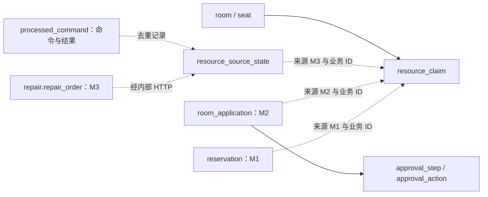
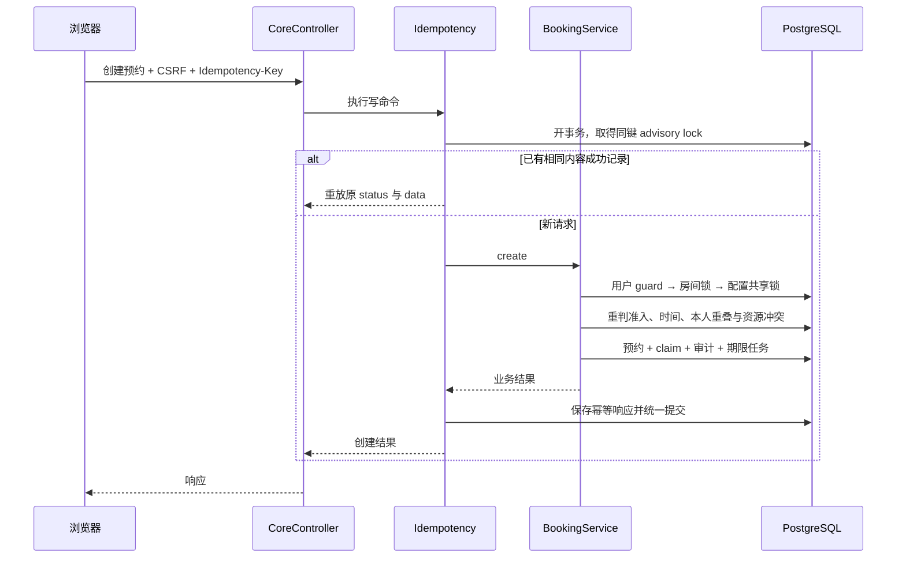
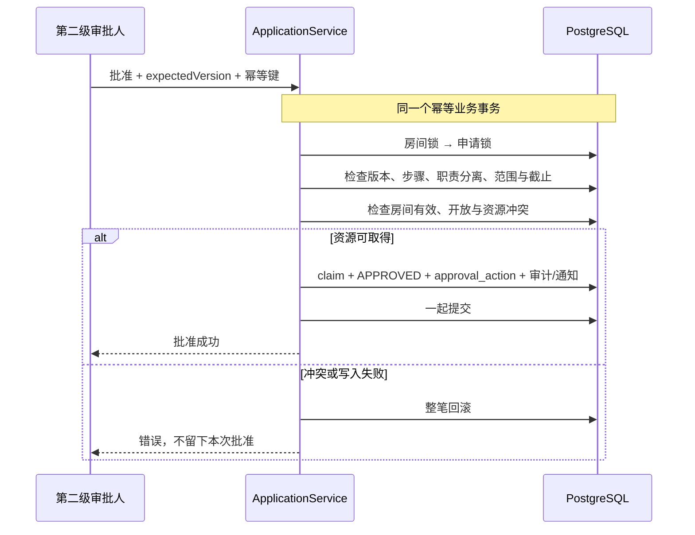
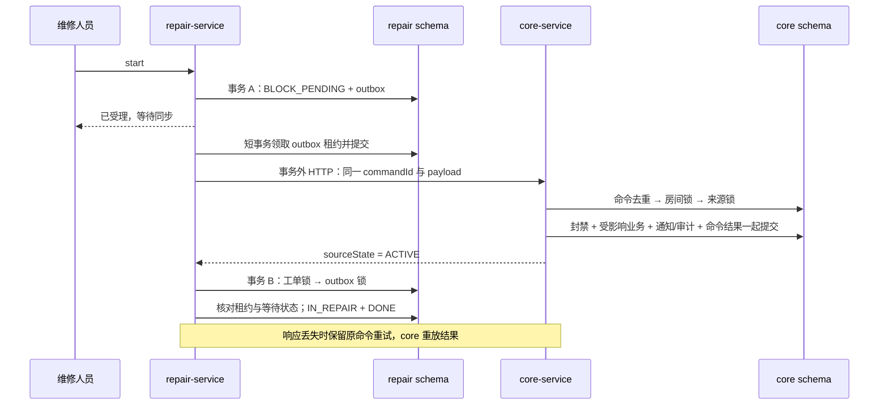
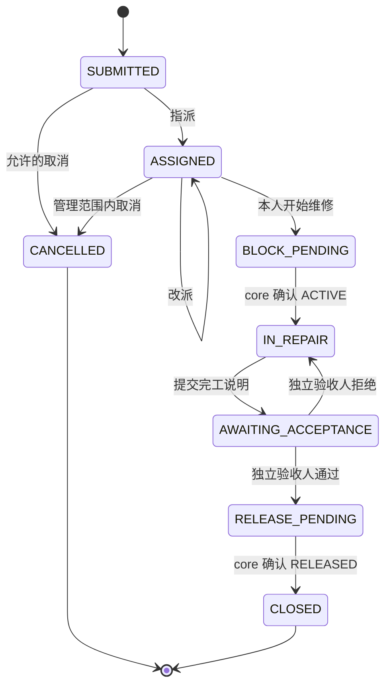
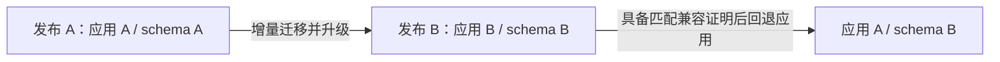

# 数据一致性与恢复

[架构总览](README.md) · [身份与安全](security.md) · [后端开发](../development/backend.md)

读这一页应能回答：资源由谁裁决、状态变化在哪个事务提交、重复或迟到命令如何处理、应用升级后为什么不能随意回退数据库。这里描述当前实现；业务字段与完整验收要求仍以 [PRD](../../01_PRD.md) 和 [OpenAPI](../../contracts/openapi/README.md) 为准。

## 哪些数据必须一起理解？

core 的 `resource_claim` 是占用账本：M1 对应座位，M2 对应整室时段，M3 对应整室维修封禁。账本的 `(source_type, source_id)` 唯一；`released_at` 标记释放，历史来源不被改写成另一笔业务。房间行锁下做冲突检查，而不是靠前端或者“查询可用”来保证互斥。

虚线是业务来源或调用关系，不是数据库外键。尤其 repair 的工单 ID、房间 ID、用户 ID 不建立跨业务 schema 外键。core 内部实体间的外键、唯一约束及索引见 [core DDL](../../db/migration/core/V20261022000100__core_schema.sql)。

repair 的聚合围绕工单展开：[repair DDL](../../db/migration/repair/V20261022120000__repair_domain.sql) 中，历史、验收、评分、outbox、期限任务引用 `repair_order`。`outbox_command` 保存不可变命令内容及投递状态；`scheduled_task` 保存期限触发条件；两者不能互相替代。账号、角色和绑定范围保存在 core，共享登录身份保存在 session，详见 [安全指南](security.md)。

## 三条关键业务链如何提交？

### 预约：一次提交，同时保护学生和座位

业务时间使用 `Asia/Shanghai`，API 时间必须带偏移，区间为 `[start, end)`；开始严格晚于当前时间、结束受 14 天边界约束，且按整点小时覆盖完整开放时段。最长时长取创建时配置快照。具体边界判断在 [DomainPolicy][policy]。

用户 guard 把同一学生跨房间的竞争串行化；房间锁让该房间内座位、整室申请和维修统一竞争。任一校验或数据库写入失败，业务与成功幂等记录一起回滚。[BookingService][booking] 先用标量查房间 ID，持房间锁后才加载业务实体，避免等待锁之前的 ORM 缓存状态被继续使用。

预约状态从 `RESERVED` 开始；在 `[start, start+15min)` 签到后为 `CHECKED_IN`，到结束时间为 `COMPLETED`。未签到到限为 `NO_SHOW` 并创建一次违约；正常取消为 `CANCELLED`。维修把受影响的未开始/未签到预约取消、已签到预约转为 `INTERRUPTED`，不创建维修违约。

### 最终审批：批准本身必须能取得资源

整室申请提交后为 `PENDING`，不预占资源。第一级通过只是推进步骤；第二级通过才申请整室占用。此时可能已被其他预约或维修占用，所以“第一级已通过”不能承诺最终成功。

[ApplicationService][application] 使用同一个事务落审批动作、步骤和占用。申请人不能自批，同一人不能完成两级；到截止仍待审批则 `EXPIRED`，拒绝为 `REJECTED`，撤销或维修影响为 `CANCELLED`，批准后的申请到结束时间转 `COMPLETED`。拥有多个角色也不能绕过这些条件。

### 维修：本地状态与远端资源分阶段确认

开始维修时，repair 先保存 `BLOCK_PENDING` 和 BLOCK outbox，再由 worker 投递到 core；确认 core 返回来源状态 `ACTIVE` 后，工单才转 `IN_REPAIR`。验收通过后同理先进入 `RELEASE_PENDING`，确认 `RELEASED` 才转 `CLOSED`。这里没有跨服务数据库事务。

[RepairService][repairservice] 负责本地事务，[RepairWorker][worker] 的领取事务已在 HTTP 前结束，网络等待不持有该投递的数据库锁。确认时核对当前租约和工单资源版本。资源接口恢复后重试原命令；人工“重试同步”也不创建新资源来源。若整个 core 不可用，repair 无法验证会话/权限，用户动作先被拒绝；只有资源链路故障且授权可用时，用户动作才能形成等待同步记录。详见 [安全失败行为](security.md)。

评分只附加到已关闭工单，不增加新状态。HTTP 成功或工单 `CLOSED` 仅说明该动作/该来源已处理，不保证房间当前可用：另一个维修来源或管理员停用仍可阻止使用。维修只释放自身来源，不恢复已经取消的预约或申请。

## 为什么重试和乱序不会重复占用？

| 层次 | 去重标识与当前实现 | 不能混淆的边界 |
| --- | --- | --- |
| core 用户写入 | 账号、方法、规范路径、UUID `Idempotency-Key`；[Idempotency][idempotency] 在事务内用 advisory lock 串行同键，保存成功 status/data | 同键不同规范化内容返回 409；异常回滚后可同键重试。记录写入 24 小时到期元数据，不应理解为恰好 24 小时自动删除 |
| repair 用户写入 | 同类键合同；[RepairService][repairservice] 使用本地事务、唯一约束与成功记录重读 | 成功业务效果和幂等结果一并提交；不要将其实现画成 core 的 advisory lock 路径 |
| core 内部命令 | `processed_command` 永久保存 commandId、内容哈希、结果；同 ID 不同内容拒绝 | 解决同一命令重复发送，包括“已提交但响应丢失” |
| M3 资源来源 | `resource_source_state` 记录该工单的最大 sourceVersion 与状态；BLOCK 为 1，RELEASE 为 2 | RELEASE 留墓碑；迟到 BLOCK 返回已释放状态，不复活占用。新的命令 ID 也绕不过来源顺序 |

来源固定后不能改指已有占用的另一个房间。[ResourceService.command][resource] 对重复、迟到和版本冲突分别处理；repair 还检查返回的 `sourceState` 与等待动作一致，不能把任意 HTTP 200 当作同步完成。

## 新增事务应遵循哪些锁顺序？

下表是主要业务路径的实际顺序，不是要求所有操作都取得所有锁。表中的配置锁指读取配置总版本行时的共享锁，不能被误读为所有业务首先锁配置。

| 路径 | 当前顺序 | 目的 |
| --- | --- | --- |
| core 公开幂等写入 | 幂等 advisory lock → 各业务锁 | 同一请求不重复执行；不代替资源锁 |
| M1 创建 | 用户 `booking_guard` → room → `config_revision` 共享锁 | 同用户跨房间互斥；配置版本和最大时长同一快照 |
| M1 状态操作 | room → reservation | 与维修及其他资源变化保持同序 |
| M2 创建 | room → `config_revision` 共享锁 | 创建快照，不占资源 |
| M2 审批/取消 | room → room_application | 最终批准与资源变化原子化 |
| M3 core 命令 | command advisory lock → room → source advisory lock | 命令去重、资源互斥、来源顺序 |
| repair 投递确认/人工重试 | repair_order → outbox_command | 避免确认和重试反向持锁；领取时仅短暂锁 outbox |
| repair 期限任务 | scheduled_task → repair_order | 持锁后重判状态与验收轮次 |

管理端资源停启也会影响预约，应先读 [AdministrationLocks](../../services/core-service/src/main/java/com/campus/studyroom/core/AdministrationLocks.java) 与 [管理模块参考](../modules/administration.md)。配置更新取得版本行排他锁；旧订单继续使用创建时的 `config_version` 与最大时长，不追溯修改历史。

## 停机、发信失败和发布暂停如何恢复？

期限任务和通知与触发业务同事务保存。core 的 [TaskExecutor][tasks] 在执行时重新持锁并判断当前状态，重启优先处理 NO_SHOW，过时提醒不补发；失败保存次数与下次尝试时间。repair 的期限任务检查状态和验收轮次，只触发相应通知，不自动替用户批准或验收。

[Notifications][notifications] 以来源、事件、周期、收件人、通道去重。每次领取生成独立租约令牌，租约为 120 秒；[Jobs][jobs] 在领取事务外调用 SMTP，随后按租约确认。旧发送者不能覆盖新领取结果。SMTP 已收信但确认丢失时仍可能再次发信，因此数据库去重不等于外部邮件严格“只送一次”。失败前期退避，第 8 次起每 300 秒继续重试；管理员重试复用原通知，标记已读与发送状态独立。

repair outbox 同样有持久重试、120 秒租约和第 8 次后的持续告警；重启不生成替代命令。`CONTROL_DIR/jobs-paused` 阻止领取新后台工作，私网 `/actuator/jobs` 报告后台和业务请求活动数。发布先开启维护，再暂停领取并等在途工作排空；超时不能强行越过迁移门禁。执行步骤见 [运维手册](../operations/runbook.md)，实现见 [发布控制器](../../scripts/studyroom.py)。

## 迁移与应用回退如何共存？

数据库结构由独立 [MigrationRunner][migration] 按 `session → core → repair` 运行 Flyway；应用关闭自动 Flyway，使用 Hibernate `validate`。已应用的迁移文件不可重写，新增变化应使用增量迁移。迁移目录分别是 [session](../../db/migration/session)、[core](../../db/migration/core)、[repair](../../db/migration/repair)。

初始化也有不同用途：`reference` 写角色/权限等基础字典；`demo` 仅在 local/dev/test 写演示账号与资源；`bootstrap` 初始化首个系统管理员。演示数据不能混入正式部署，种子不代替 schema 迁移。数据库账号权限见 [安全指南](security.md)。

`current-release.json` 记录最后成功应用组合，`schema-release.json` 记录实际数据库结构身份。应用回退只切换 web/core/repair，不执行数据库降级；所以两份状态可能不同。迁移按 schema 分别执行，失败时前面的迁移可能已提交，`pending-release` 必须保留用于恢复，不能清空文件掩盖实际状态。

兼容证明要绑定目标应用清单、三个镜像 ID、迁移集合，以及实际 PostgreSQL/Flyway 指纹；不能复用不匹配的旧证明。演练还验证原会话和业务记录可读写，不能重新登录掩盖序列化兼容问题。状态格式、失败分支和恢复门禁以 [发布参考](../modules/release-operations.md) 为准；已有证据入口见 [发布演练](../evidence/release/README.md)。

## 文档中的“版本”和“ID”分别指什么？

| 名称 | 用途 | 不代表什么 |
| --- | --- | --- |
| 实体 `version` / 请求 `expectedVersion` | 检查用户提交时所见业务对象是否仍为同一版本；过期返回 409 | 不是资源来源顺序，也不是发布版本 |
| `authVersion` | 账号安全变更后使旧会话失效 | 不是权限列表快照；每次请求仍重新授权 |
| `sourceVersion` / 工单 `resourceVersion` | M3 对 core 的来源演进：1 封禁、2 释放 | 不随每次改派/编辑等业务版本一起递增 |
| `config_version` | 订单创建时采用的配置总版本 | 后续改配置不改变旧订单快照 |
| Flyway schema version | 某 schema 已执行的迁移历史 | 不能从当前应用版本推断 |
| `requestId` | 串联一次请求、服务调用、审计和日志 | 不具备去重语义 |
| `Idempotency-Key` / `commandId` | 分别标识用户写命令与内部持久命令 | 不能拿新 ID 替代失败命令来绕过状态检查 |
| `releaseId` / Git commit | 标识一次发布及其源码提交 | 不单独证明正在运行的镜像或数据库身份 |
| 应用 Docker image ID | 当前发布清单固定的构建内容身份 | 不等同于 registry 中的 OCI manifest digest；基础镜像 digest 是另一层身份 |
| 发布清单 SHA | 校验完整发布组合及元数据 | 不等同于任一镜像 ID 或源码 commit |

对每条链路的实现与测试映射见 [架构总览](README.md)。这些源码说明与历史证据不替代当前改动需要执行的 [测试门禁](../development/testing.md)。

[policy]: ../../services/core-service/src/main/java/com/campus/studyroom/core/DomainPolicy.java
[booking]: ../../services/core-service/src/main/java/com/campus/studyroom/core/BookingService.java
[application]: ../../services/core-service/src/main/java/com/campus/studyroom/core/ApplicationService.java
[resource]: ../../services/core-service/src/main/java/com/campus/studyroom/core/ResourceService.java
[idempotency]: ../../services/core-service/src/main/java/com/campus/studyroom/core/Idempotency.java
[repairservice]: ../../services/repair-service/src/main/java/com/campus/studyroom/repair/RepairService.java
[worker]: ../../services/repair-service/src/main/java/com/campus/studyroom/repair/RepairWorker.java
[tasks]: ../../services/core-service/src/main/java/com/campus/studyroom/core/TaskExecutor.java
[notifications]: ../../services/core-service/src/main/java/com/campus/studyroom/core/Notifications.java
[jobs]: ../../services/core-service/src/main/java/com/campus/studyroom/core/Jobs.java
[migration]: ../../tools/migration-runner/src/main/java/com/campus/studyroom/migration/MigrationRunner.java
