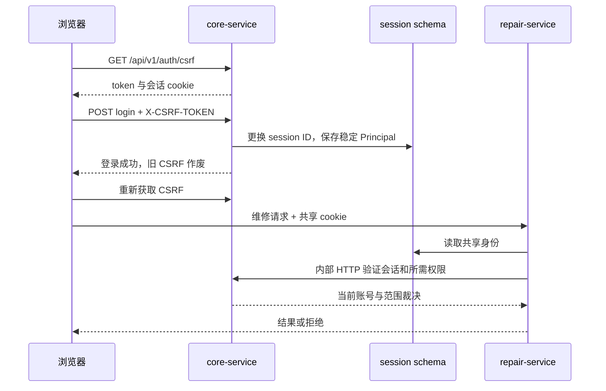

# 身份、权限与信任边界

[架构总览](README.md) · [数据一致性与恢复](data-consistency.md) · [API 开发](../development/api.md)

系统的授权答案由后端根据当前账号、角色、数据范围和业务状态共同决定。前端根据 `allowedActions` 展示按钮，提交后仍须重新校验；按钮可见不能作为执行授权。完整角色业务要求见 [PRD](../../01_PRD.md)，本页说明它们如何落到当前源码。

## 两个后端怎样共享登录？

core 执行登录，Spring Session JDBC 把会话保存在 `session.SPRING_SESSION` 及属性表。core 与 repair 使用同名 cookie `STUDYROOMSESSION`、路径 `/`、HttpOnly、SameSite=Lax；本机 HTTP 的 Secure 默认关闭，TLS 部署必须启用对应配置。会话闲置超时 30 分钟，登录最长 8 小时。

共享的 [SessionPrincipal][principal] 只有 `userId`、`authVersion`、`authenticatedAt`，具有稳定序列化标识，不保存角色实体或权限快照。两服务共享的是身份格式；repair 不实现独立登录，也不从 core 业务表读取密码或权限。

[AuthController][auth] 在登录成功后轮换 session ID 并清除旧 CSRF；客户端需要刷新 token。除内部独立服务认证链外，公开写请求受 CSRF 保护，使用 `X-CSRF-TOKEN`；业务写请求还需要幂等键，状态操作携带 `expectedVersion`。这三个值分别解决跨站伪造、重复提交和过期状态，不能互相替代。

core 在请求过滤器中检查账号启用、`authVersion` 与登录最长时限；repair 每个受保护维修请求通过 core 再检查身份。账号/角色/范围/密码等安全变更更新受影响账号的 `authVersion`，旧会话随后返回 401。具体路径见 [SecurityConfiguration][coresecurity]、[RepairSecurity][repairsecurity]、[AdminService][admin]。

## 一个权限为何不能借用另一个角色的范围？

数据库关系是 `app_user → user_role → role → role_permission`，范围在该条 `user_role` 的 `user_role_scope` 上。管理动作必须在**同一条角色绑定**里同时找到权限与覆盖目标的范围，不能把绑定 A 的审批权限和绑定 B 的 ALL 范围拼成授权。停用角色不参与裁决。

实际支持五种范围，字段校验与迁移见 [SELF 增量迁移](../../db/migration/core/V20261022130000__self_role_scope.sql)：

| 范围 | 当前含义 | 使用时的边界 |
| --- | --- | --- |
| `SELF` | 本人业务语义的绑定标记；无 roomId/departmentId | 本人读取/收尾由业务所有权判断；SELF 不会在通用范围查询中授予任意房间管理权 |
| `DEPARTMENT` | 绑定指定院系 | 校验对象对应的院系；例如院系审批使用申请人的院系，房间管理使用房间院系，不简单等同操作者本人院系 |
| `ROOM` | 绑定指定教室 | 只覆盖该教室；不能延伸到其他教室或无教室的系统对象 |
| `SHARED` | 公共教室，即 `room.department_id` 为空 | 按教室维度授权时匹配公共教室；不用于授予一级院系审批，也不等于所有教室 |
| `ALL` | 该绑定权限的全部适用对象 | 仍需权限、对象状态与职责分离校验；不能创造角色未拥有的权限 |

[AccessService](../../services/core-service/src/main/java/com/campus/studyroom/core/AccessService.java) 是动态授权入口，[UserRoleRepository][roles] 将权限与范围在同一绑定内关联；[ReadQueries][queries] 为列表查询应用相同范围条件。`SELF` 没有被通用 `grantsScope` 当成房间管理授权，必须注意业务所有权路径与管理范围路径的区别。

一级院系审批传入申请人的院系（非空），不是教室的院系；因此即使申请公共教室，`SHARED` 也不匹配一级审批。空间审批等 `roomScope` 路径才按教室的院系判断公共范围，见 [ApplicationService][application]。

创建预约/申请/报修还检查资源准入：公共教室可用，院系教室要求申请者所属院系匹配，并同时满足创建权限及资源有效等条件。本人已有业务的读取与允许的收尾存在所有权例外，即使已撤去“新建”权限，也不会因此让已有记录失去必要的收尾路径；这不绕过账号失效、状态或职责分离。

## 哪些限制不能用“管理员”绕过？

默认角色集合由 [reference 初始化](../../tools/migration-runner/src/main/java/com/campus/studyroom/migration/MigrationRunner.java) 定义。`SYSTEM_ADMIN` 管账号、角色、配置、审计和通知，不隐式拥有教室申请审批权限。管理员即使另获业务角色，也仍受这些规则限制：

- 整室申请禁止本人审批，同一人不能完成两个步骤；实际检查在 [ApplicationService][application]。
- 维修操作须同时符合工单状态和指派关系，维修人不能验收自己的工作；报修人也是维修人时不能因所有权而绕过限制，见 [RepairAccess][repairaccess] 与 [RepairPolicy][repairpolicy]。
- 普通用户不能枚举他人预约、申请、报修详情；列表过滤与详情所有权检查都必须保留。无权读取的对象按对应接口合同隐藏，不能只在 UI 隐藏链接。
- 每日教室签到明码只供具有相应教室范围的展示权限使用；普通学生提交代码校验，不能读取明码。
- 管理端保留最后一个有效系统管理员、系统角色与父子资源有效性等约束，见 [管理参考](../modules/administration.md)。

服务端返回的 `allowedActions` 是当前身份和对象状态的交集。页面轮询或刷新能得到新动作，执行时后端仍会检查权限、版本和状态，因此前端不得自行根据角色名推断“总能操作”。

## repair 依赖 core 授权时怎样处理故障？

[CoreClient][client] 使用内部 HTTP 查询会话、权限、房间和人员引用。一次请求内的 [RepairAccess][repairaccess] 会复用同一权限判断，避免重复网络调用；它不跨请求缓存，也不把权限持久化到会话。

| 情况 | 当前处理 | 原因 |
| --- | --- | --- |
| core 确认身份失效 | repair 返回 401，清理旧会话 | 禁用或安全变更必须在两个服务生效 |
| 授权服务不可达或无法返回可信裁决 | 返回 503 `AUTHORIZATION_UNAVAILABLE`，不继续该用户动作 | 不能把网络失败当作允许，也不能用过期权限顶替 |
| 只有资源命令链路中断，授权可用 | 合法动作可保存为 `BLOCK_PENDING` / `RELEASE_PENDING`，后台重试 | 工单本地提交和资源确认分开；详细状态与 outbox 见 [数据一致性](data-consistency.md) |
| 授权通过但对象版本/状态变化 | 按合同返回冲突，刷新后重新判断 | 权限不是锁，也不保证对象仍处于可操作状态 |

故障矩阵的原始边界见 [真实 HTTP 证据](../evidence/repair-fault-matrix.md)。它不能被简化成“core 挂了时维修也能照常受理”。

## 网络与数据库分别保护哪一层？

公开 Nginx 拒绝 `/internal` 与 `/actuator`；内部 core 路由使用单独的无状态 HTTP Basic 服务身份链，要求 `SERVICE` authority，禁用会话式 CSRF。普通用户 cookie 不能替代服务凭证。当前 `CORE_INTERNAL_URL` 在 Compose 私网使用 HTTP，这不是 mTLS 架构；跨主机部署需要单独设计并验证传输保护，不能直接公开此端口。

| 数据库账号 | 可访问 schema | 不应拥有的能力 |
| --- | --- | --- |
| `studyroom_core` | `core`、`session` | 无 repair 业务访问权；无 schema DDL 所有权 |
| `studyroom_repair` | `repair`、`session` | 无 core 业务访问权；不能通过 SQL 代替内部授权/资源 API |
| `studyroom_migration` | 拥有 `core`、`repair`、`session` | 仅供一次性迁移/初始化，不作为应用运行账号 |
| `studyroom_bootstrap` | PostgreSQL 初始化管理 | 不作为业务连接账号 |

边界由 [初始化授权脚本](../../infra/compose/init-db.sh)、[Compose 挂载与网络](../../infra/compose/compose.yml) 以及服务配置共同实现。运行账号通常具有所属业务表的 DML 权限，但 [迁移入口](../../scripts/studyroom.py) 完成后另将审计表收紧为 SELECT/INSERT，不能把表格理解成所有表可任意修改，也不能跳过标准迁移入口。共享 session schema 是明确的共享信任边界：两服务必须使用兼容、稳定的 Principal；升级校验原会话见 [发布兼容](data-consistency.md)。

## 秘密、审计与日志如何分工？

账号密码只保存 BCrypt 散列。签到码为了校验与授权展示，分别保存 BCrypt hash 和 AES-256-GCM 密文，每条使用随机 nonce；密钥从运行配置注入，代码见 [CheckinCodes][codes]。数据库备份不包含这个密钥，迁移部署须通过受控渠道保留它；密钥丢失不能通过数据库备份恢复明码。

应用仅挂载自己需要的数据库、内部服务和签到密钥；秘密文件放在环境状态目录，不放进源码、清单、镜像或文档。管理员初始化与演示账号的使用方法见 [安装指南](../operations/installation.md)、[演示账号](../development/demo-accounts.md)，本页不提供秘密值。

业务审计记录 USER、SERVICE、JOB 身份、对象、前后状态与 requestId，并与业务事务一起提交。运行日志用于定位请求、耗时、错误码与投递，不承担业务审计表职责。结构化日志格式见 [StudyroomLogFormatter](../../modules/security-common/src/main/java/com/campus/studyroom/security/StudyroomLogFormatter.java)；密码、cookie、CSRF、Authorization 和签到码不应写入普通日志、截图或测试工件。浏览器工件的处理见 [浏览器测试说明](../../tests/browser/README.md)。

## 改安全逻辑时看哪些验证？

| 关注点 | 可执行入口 / 现有检查 |
| --- | --- |
| 账号停用、角色与范围变更、SELF 校验 | [AdminPersistenceTest](../../services/core-service/src/test/java/com/campus/studyroom/core/AdminPersistenceTest.java)、[admin_http.py](../../tests/integration/admin_http.py) |
| 本人隐私、院系/教室范围、禁止自批 | [CoreAcceptanceMatrixTest](../../services/core-service/src/test/java/com/campus/studyroom/core/CoreAcceptanceMatrixTest.java)、[core_roles_http.py](../../tests/integration/core_roles_http.py) |
| 内部身份不接受普通用户、授权不可用时拒绝 | [InternalServiceAuthenticationProviderTest](../../services/core-service/src/test/java/com/campus/studyroom/core/InternalServiceAuthenticationProviderTest.java)、[run_fault_matrix.py](../../tests/integration/run_fault_matrix.py) |
| 维修身份、指派、验收分离与共享会话 | [RepairPersistenceTest](../../services/repair-service/src/test/java/com/campus/studyroom/repair/RepairPersistenceTest.java)、[repair_acceptance_http.py](../../tests/integration/repair_acceptance_http.py) |
| 审计不可删除、限流和租约 | [SharedPersistenceTest](../../services/core-service/src/test/java/com/campus/studyroom/core/SharedPersistenceTest.java) |
| 日志与浏览器工件不携带秘密 | [logging_http.py](../../tests/integration/logging_http.py)、[artifact-safety.test.mjs](../../tests/browser/artifact-safety.test.mjs) |

这些链接是变更时的验证入口，不表示本页重新运行了测试。检查结果和适用版本应从 [证据索引](../evidence/README.md) 追溯，执行方式见 [测试指南](../development/testing.md)。

[principal]: ../../modules/security-common/src/main/java/com/campus/studyroom/security/SessionPrincipal.java
[auth]: ../../services/core-service/src/main/java/com/campus/studyroom/core/AuthController.java
[coresecurity]: ../../services/core-service/src/main/java/com/campus/studyroom/core/SecurityConfiguration.java
[repairsecurity]: ../../services/repair-service/src/main/java/com/campus/studyroom/repair/RepairSecurity.java
[admin]: ../../services/core-service/src/main/java/com/campus/studyroom/core/AdminService.java
[roles]: ../../services/core-service/src/main/java/com/campus/studyroom/core/persistence/UserRoleRepository.java
[queries]: ../../services/core-service/src/main/java/com/campus/studyroom/core/ReadQueries.java
[application]: ../../services/core-service/src/main/java/com/campus/studyroom/core/ApplicationService.java
[repairaccess]: ../../services/repair-service/src/main/java/com/campus/studyroom/repair/RepairAccess.java
[repairpolicy]: ../../services/repair-service/src/main/java/com/campus/studyroom/repair/RepairPolicy.java
[client]: ../../services/repair-service/src/main/java/com/campus/studyroom/repair/CoreClient.java
[codes]: ../../services/core-service/src/main/java/com/campus/studyroom/core/CheckinCodes.java
