# 前端开发指南

[文档首页](../README.md) · [开发首页](README.md) · [用户手册](../user-guide/README.md)

先按[本地开发](local-setup.md)启动后端，再从仓库根目录运行：

```sh
./scripts/web install --frozen-lockfile
./scripts/web dev
```

打开 `http://localhost:8000`，用该环境的[演示账号与密码文件](demo-accounts.md)登录。能查询教室、刷新后仍保持登录，才说明前后端链路可用。系统管理员首页是账号与授权，试预约请用学生账号。8000 是开发代理页，源码容器新装默认 18080，[现有服务器实例](../operations/current-instance.md)使用独立生产状态与 HTTPS 入口；不能混用它们的密码、状态目录或测试结果。原生后端更新需要 `native-restart`，仅重跑 `dev-up` 不替换运行中的 JAR。

## 代码地图与路由

| 修改内容 | 入口 |
| --- | --- |
| 路由、导航、角色首页、布局、主题 | [App.tsx](../../apps/web/src/pages/App.tsx) |
| 会话 / 权限展示 | [services/session.tsx](../../apps/web/src/services/session.tsx) / [access.ts](../../apps/web/src/access.ts) |
| 查询、弹窗动作、状态、时间、错误与加载 | [components/business/common.tsx](../../apps/web/src/components/business/common.tsx) |
| 同源 HTTP、CSRF、错误、生成客户端适配器 | [services/api.ts](../../apps/web/src/services/api.ts) |
| 补充类型 / 生成类型 | [types.ts](../../apps/web/src/services/types.ts) / [generated](../../apps/web/src/services/generated) |
| 响应式样式 / 代理配置 | [global.css](../../apps/web/src/global.css) / [.umirc.ts](../../apps/web/.umirc.ts) |

Umi 只注册 `/* → App`。真实分发在 App 的 `nav`、`homePath`、`switch(path)`；新增文件不会自动产生页面。下表只描述入口展示，后端仍校验数据范围与动作。

| URL | 页面文件 / 导出 | 菜单门槛与详情 |
| --- | --- | --- |
| `/login` | [Login.tsx](../../apps/web/src/pages/Login.tsx) | 未登录；成功后角色首页 |
| `/seats` | [Seats.tsx](../../apps/web/src/pages/Seats.tsx) | `seat:search`；再次预约带入教室与座位 |
| `/reservations` | [Reservations.tsx](../../apps/web/src/pages/Reservations.tsx) | 登录可见，列表为本人记录；`?id=UUID` 打开详情 |
| `/applications` | [Applications.tsx](../../apps/web/src/pages/Applications.tsx) | 按申请/审批权限显示视图；`?id=UUID` |
| `/repairs` | [Repairs.tsx](../../apps/web/src/pages/Repairs.tsx) | 按报修/处理/管理权限显示视图；`?id=UUID` |
| `/notifications` | [Notifications.tsx](../../apps/web/src/pages/Notifications.tsx) | 本人通知；送达管理另需权限 |
| `/admin/users` | [Admin.tsx](../../apps/web/src/pages/Admin.tsx) → `Users` | `user:manage` |
| `/admin/roles` | Admin → `Roles` | `role:manage` |
| `/admin/spaces` | Admin → `Spaces` | `room:manage` 或 `user:manage`；页内按各自权限维护教室或组织资料 |
| `/admin/config` | Admin → `Config` | `config:manage` |
| `/admin/statistics` | Admin → `Statistics` | `statistics:read` |
| `/admin/audit` | Admin → `Audit` | `audit:read` |
| `/display/:roomId` | [Display.tsx](../../apps/web/src/pages/Display.tsx) | 独立屏幕，`room:display_code` 与教室范围 |

## 请求与状态



<details>
<summary>查看或编辑 Mermaid 源码：前端请求链路</summary>

```text
flowchart LR
  Query[页面 useData] --> API[api 同源传输]
  Action[弹窗 useAction] --> API
  Generated[生成函数] --> Adapter[request 适配器]
  Adapter --> API
  API --> Proxy[Nginx 或开发代理]
  Proxy --> Core[core]
  Proxy --> Repair[repair]
```

</details>

开发代理先把 `/api/v1/repairs` 转到 8082，其余 `/api` 转到 8081。后端另有地址时才在启动进程环境设置 `REPAIR_PROXY_URL`、`CORE_PROXY_URL`，浏览器仍调用同源相对路径。

| 状态层 | 职责 |
| --- | --- |
| `SessionContext` | 当前用户和 `refresh()`；App 读取 `/auth/me`。`session-expired` 清除页面身份，`permission-changed` 重新读取身份 |
| 页面本地 state | 筛选、页码、选中记录、弹窗；没有 Redux 或全局业务缓存 |
| `useData(path)` | 加载/错误/数据，忽略失效请求结果；path、`reload()`、`business-data-changed` 触发读取 |
| `useAction(onSuccess)` | 校验、确认、忙碌、幂等键与失败提示；成功回调刷新，409 广播业务数据变化 |

`api()` 带 Cookie/请求号；写请求取 CSRF，业务写入另带幂等键。响应已解包 `data`，204 为 `undefined`；生成函数经同一 `request()`，不要再读 `response.data.data`。登录成功后清除并重新获取 CSRF；现有401/403事件本身只更新页面身份，不清除 token 缓存。完整协议见 [API 指南](api.md)。

## 改一个页面

1. 从路由表找到代码和[用户操作](../user-guide/pages.md)。新增页面同步 App 的导入、分发、导航权限和默认首页逻辑。
2. 用 `useData` 管查询；明确加载、失败、空结果、正常内容。教室等依赖选项未就绪时，不开放依赖它的创建入口。
3. 用 `useAction` 提交真实接口、body 与最新 `expectedVersion`；成功后刷新列表/详情。参考 Reservations 的 `controls`，不要写每次重试都换 UUID 的函数。
4. 按服务端 `allowedActions` 显示动作，按 permission 显示入口。范围由后端验证；同一角色绑定的 permission/scope 必须同时成立。
5. 检查桌面和 375px 的加载、空态、错误、弹窗、键盘与成功结果，同步用户手册。

`PageHeading` 管标题层级，`Status` 管状态翻译/颜色，`Failure` 显示错误及请求号，`EmptyState` 解释空结果，`LoadingBlock` 表示加载，`Identifier` 在详情展示短编号并复制完整 UUID；业务选项必须显示名称，不用 UUID 替代缺失名称。优先复用公共入口。

时间用 `shanghai()`、`dateTime()`、`slotLabel()`；提交带偏移 RFC3339，整点、左闭右开。历史筛选结束日期转下一天 00:00 上界；14 天规则约束预约结束时刻。不能用浏览器本地时区替代上海时区。

主题 token 在 App 的 `ConfigProvider`；global.css 有 800/1150/1600 断点、`focus-visible`、reduced-motion。手机业务记录用卡片，管理宽表在表内滚动，整页/弹层不溢出。公共弹窗 zIndex=1200，按钮保持稳定 `aria-label`，忙碌用 `aria-busy`，loading 图标不混入名称。

800px 及以下的 `.ant-modal` 使用中心动画原点（`transform-origin: center`），防止桌面点击位置在缩至 375px 后成为屏幕外的旧动画原点。调整弹窗样式时，同时检查打开状态和退出动画；浏览器管理员场景会在桌面打开弹窗、缩至 375px 后逐帧检查关闭过程。布局采样及原有 1px / 5 秒标准见[测试指南](testing.md#手机弹窗与布局检查)，实际通过以本轮运行报告为准。

## 失败与重试

下表中的自动保留请求、24小时保护、409广播/禁确认由公共 `useAction` 提供。授权独立组件 AdminAccess.tsx 也会冻结未确认请求、保留原键重试、拦截冲突及过期重试，并提醒未保存退出。“配置权限”“每周开放时间”仍采用独立保存弹窗，冲突时需要关闭、刷新并重新打开。修改这些页面时按[用户恢复说明](../user-guide/faq.md)核对，不能把公共Hook行为当成所有表单现状。

| 结果 | 页面处理 |
| --- | --- |
| 查询网络失败 | 错误和查询重试，保留筛选 |
| 写入网络失败 / 20 秒超时，`RESULT_UNCONFIRMED` | 不断言成功或失败；保留原表单/body/key，显示“重试原请求” |
| 原请求超过 24 小时 | 禁自动重发；先查业务记录再决定新操作 |
| 400 等明确输入失败 | 显示原因，修正输入形成新意图 |
| 401 / 403 | 登录失效 / 重新取权限；提示恢复登录或联系管理员 |
| 404 | 记录不存在或不可见，不泄露他人记录 |
| 409 | 刷新业务数据，禁确认，“返回并重新选择”，重新取版本/可用性 |
| 429 / 503 | 遵循限流/维护提示，不无限重试业务写入 |

`useAction` 用 path/method/body 指纹保留 key。关闭弹窗后无法依靠它恢复先前意图，先查记录。维修“下架同步中/恢复同步中”不能显示完成；详情每 2 秒查询，60 秒后停页面轮询，后台仍重试；手动重试同步开启新窗口。

## 改一个接口

先改 [OpenAPI](../../contracts/openapi/README.md)，与后端确认字段、状态、错误；规范使用 JSON 语法的 YAML。公共 core/repairs 契约生成到 `services/generated/`，内部契约不进浏览器。在仓库根目录执行：

```sh
./scripts/web generate
git diff -- apps/web/src/services/generated
./scripts/web typecheck
./scripts/web test
./scripts/web build
```

审查生成 diff，更新调用方与手写补充类型，不手改生成目录。生成器使用 `dataFields: ['data']`；认证使用生成函数，部分业务仍通过 `useData/api`，并非全仓已迁移。`./scripts/check` 检查生成漂移；用 `git diff --exit-code -- apps/web/src/services/generated` 时，要与已提交的预期生成物比较。

## 选择验证

| 检查 | 命令与位置 | 前置、证明范围、产物 |
| --- | --- | --- |
| 类型 | 根目录 `./scripts/web typecheck` | 依赖已安装；不证明交互 |
| 客户端 | 根目录 `./scripts/web test` | Node24；fetch 边界测试，不是 React 组件/E2E |
| 构建 | 根目录 `./scripts/web build` | 输出 `apps/web/dist/`；不证明后端业务 |
| 全仓集成 | 根目录 `./scripts/check` | 见[测试指南](testing.md)，独立检查环境含 PG/HTTP，不含浏览器 |
| 真实浏览器 | `tests/browser` 的 `npm test` | 隔离的已打包三应用、demo 数据、显式写入许可；输出 `output/browser/` |

8000 可手动调试。正式 E2E 启动校验 `/version.json` 与两个后端版本：releaseId 非空且一致，commit 一致且为 40 位 SHA。开发页不能代替它；先读[安装](../operations/installation.md)和[浏览器运行说明](../../tests/browser/README.md)，不要默认指向已有交付实例。

真实套件覆盖登录/会话/权限、M1 冲突与再次预约、M2 两级与驳回、M3 全流程、管理员空态、手机与网络恢复六场景。`npm run list` 仅加载，`test:report-safety` 仅隐私检查，均不是业务验收；`test:headed` 不自动执行 `pretest`，先单独运行隐私探针。

## 排查与交接

| 症状 | 下一步 |
| --- | --- |
| API 502 | 核对代理地址、两后端 readiness/日志，见本地开发指南 |
| 登录 401 | 核对目标环境、密码文件、账号启用状态 |
| 操作 403 | 查看最新身份/范围/allowedActions，角色改动后重新登录 |
| 保存 409 | 返回重选，核对最新版本与占用，不循环发旧 body |
| 报修无教室 | 区分加载/失败/空结果，先恢复查询 |
| 成功但页面未刷新 | 核对成功回调 reload、事件监听、查询 path |
| E2E 拒绝启动 | 核对 global-setup 的三应用版本，重建一致组合，不跳过门禁 |

交接提供 REQ、改动、实际命令/结果、源码和运行版本、桌面/375px 反馈、失败 requestId。不要上传密码、Cookie、CSRF、storageState 或 trace/HAR。浏览器默认关闭 trace/HAR/video，并运行真实 Chromium 失败报告隐私探针。

[历史证据](../evidence/README.md)各自绑定原版本，不等于本轮重新验收。


### 全角色交互回归

`tests/browser/usability.spec.mjs` 覆盖 11 个种子账号的角色首页、工作标签、全部页面在桌面和 375px 下的可达性，以及跨院系授权教室名称与保存对象一致性、真实签到屏。与既有业务闭环一起在 PR CI 的打包版本上执行。手动开发预览用 `mfsu: false` 保持 React 单实例；运行预览时不要并行多次 `umi setup` 重写临时目录。
